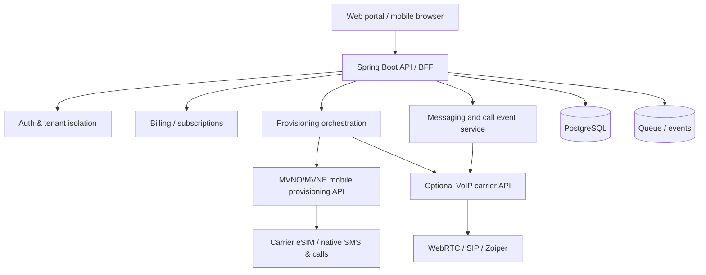

# Architecture (proposed)

## Key entities
Tenant, User, IdentityVerification, Plan, Subscription, PhoneNumber, CarrierLine, EsimProfileReference, SipCredentialReference, MessageMetadata, CallDetailRecord, UsageLedger, Invoice, AuditEvent, SupportCase.

## Principles
- Carrier abstraction: separate MobileCarrierAdapter and VoipProviderAdapter.
- Webhooks authenticated, idempotent and replay-safe; event-based provisioning state machine.
- Never assume mobile carrier SMS can be forwarded to a web inbox.
- Use hosted checkout and secure secret management; enforce tenant-level authorization.
- Encrypt sensitive data, minimize message retention, protect OTP data from staff access.
- Strong anti-abuse controls: verified customers, limits, number quotas, suspicious activity alerts.

## Example provisioning states
REQUESTED -> REVIEW_PENDING -> APPROVED -> PROVISIONING -> ESIM_ISSUED -> ACTIVATION_PENDING -> ACTIVE; with FAILED, SUSPENDED, PORT_OUT_PENDING and TERMINATED paths.
